<p align="center">
  
</p>

<p align="center">
  <a href="https://www.linkedin.com/in/joao2709"></a>
  <a href="mailto:joaopedro7253@gmail.com"></a>
  <a href="https://www.youtube.com/@jotape-exp"></a>
  <a href="https://www.instagram.com/jotape.exp"></a>
</p>

```text
$ whoami
> João Pedro de Moura Lima · São Bernardo do Campo, SP
> Ciência de Dados e IA (Fundação Santo André, 2029) · infraestrutura de redes na Tecnocomp
> transformo processos manuais em dados, automações e sistemas que rodam de verdade
```

## 🎒 Inventário

| | Projeto | O que é |
|:-:|---|---|
| **1** | **[jotape.exp](https://jotape-exp.vercel.app)** | Matemática visual: aulas animadas em Manim e Remotion sobre matemática, física e ciência de dados, publicadas no [YouTube](https://www.youtube.com/@jotape-exp) e no [Instagram](https://www.instagram.com/jotape.exp). Também é a marca do meu livro **[Ler antes de calcular](https://ler-antes.vercel.app)**. |
| **2** | **[JPX Lab]([https://www.instagram.com/jpxlabs](https://www.instagram.com/jpx.lab/))** | Meu estúdio freelance: desenvolvimento web, automação, design e dados, além de infraestrutura (cabeamento estruturado, redes e CFTV). |
| **3** | **Dados** | Pipelines de coleta, limpeza, validação e enriquecimento de dados, com relatórios e indicadores. Os projetos estão logo abaixo. |
| **4** | **Matemática** | A base de tudo. Estatística, probabilidade e modelagem são o que me levou para os dados. Meu lema: *ler antes de calcular*. |

## 🗺️ Projetos em destaque

### [Automation Leads](https://github.com/jotape2709/Automation-leads): pipeline de coleta e qualificação de leads
`Python` `pandas` `Excel` `SQLite` `Google Places API` `LLMs`

Coleta dados de empresas locais, remove duplicatas, calcula score e prioridade de cada lead, exporta planilhas estruturadas e consolida os indicadores do funil de CRM em SQLite.

### [NetInv](https://github.com/jotape2709/NetInv): inventário de rede com relatórios estruturados
`Python` `CSV` `JSON` `Multithreading` `CIDR`

Ferramenta concorrente que descobre hosts e portas abertas, valida faixas CIDR e gera relatórios em CSV, JSON e TXT prontos para análise e integração.

### [TraceLoc](https://github.com/jotape2709/TraceLoc): correlação e enriquecimento de dados
`Python` `SQLite` `REST APIs` `C/C++`

Fluxo de enriquecimento de endereços e telefones com normalização, cache em SQLite com TTL, fallbacks resilientes e saídas em CSV e JSON.

### [Vapt Vupt](https://github.com/jotape2709/vapt-vupt): estoque e cotações
`JavaScript` `REST API` `Dashboard` `Regras de negócio`

Projeto acadêmico de gestão de estoque com monitoramento de produtos, fluxo de cotação, indicadores operacionais e um dashboard para apoiar decisões de compra.

## ⚔️ Habilidades

```text
Dados           Python · pandas · NumPy · SQL · ETL · Qualidade de dados
Bancos          PostgreSQL · MySQL · SQLite · Redis
BI              Power BI · Excel · Google Sheets · Dash/Plotly · Storytelling com dados
Backend         TypeScript · NestJS · Prisma · REST APIs · PHP · Java
Frontend        React · TypeScript · HTML · CSS · JavaScript
Automação       n8n · Integração com LLMs · Shell Script · Visão computacional
Matemática      Estatística · Probabilidade · LaTeX · Manim · Remotion
Infraestrutura  TCP/IP · Cabeamento estruturado · Switches · FTTH/GPON · Linux
Ferramentas     Git · GitHub · Vercel · JSON · CSV
```

## 📜 Experiência

**Tecnocomp Tecnologia e Serviços** · Auxiliar de Instalador – Fibra Óptica
*fev/2026 – atual*

- Implantação de infraestrutura estruturada para pontos lógicos em ambientes corporativos.
- Instalação de switches, racks e patch panels, com configurações básicas de rede.
- Testes de conectividade, certificação de cabeamento e troubleshooting em projetos de grande porte.
- Desenvolvi dois sistemas internos fullstack, hoje em uso: um de pré-vendas com IA (consulta a PDFs, propostas e organização de clientes) e um sistema de educação automatizada em sala de aula para um cliente (visão computacional em Python).

**Centro de Treinamento EDASI** · Estagiário de TI e Automação
*dez/2024 – abr/2025*

- Scripts em Python para tratamento, auditoria e validação de dados.
- Automação de fluxos com n8n, MySQL e REST APIs.
- Redução de cerca de 60% do esforço manual na triagem de leads e nos relatórios.

## 🎓 Formação

- **Bacharelado em Ciência de Dados e Inteligência Artificial**: Fundação Santo André (previsão 2029)
- **Técnico em Informática**: Senac São Paulo (2023 – 2025)

## 🧪 Estudando agora

Análise exploratória e estatística aplicada · SQL, modelagem de dados e pipelines ETL · Dashboards no Power BI · Fundamentos de machine learning · Engenharia de dados e automação de fluxos

## 🏅 Certificações

`Cabeamento Estruturado` · `Fortinet NSE` · `Data Cabling System (DCS)`

<p align="center">
  
</p>
